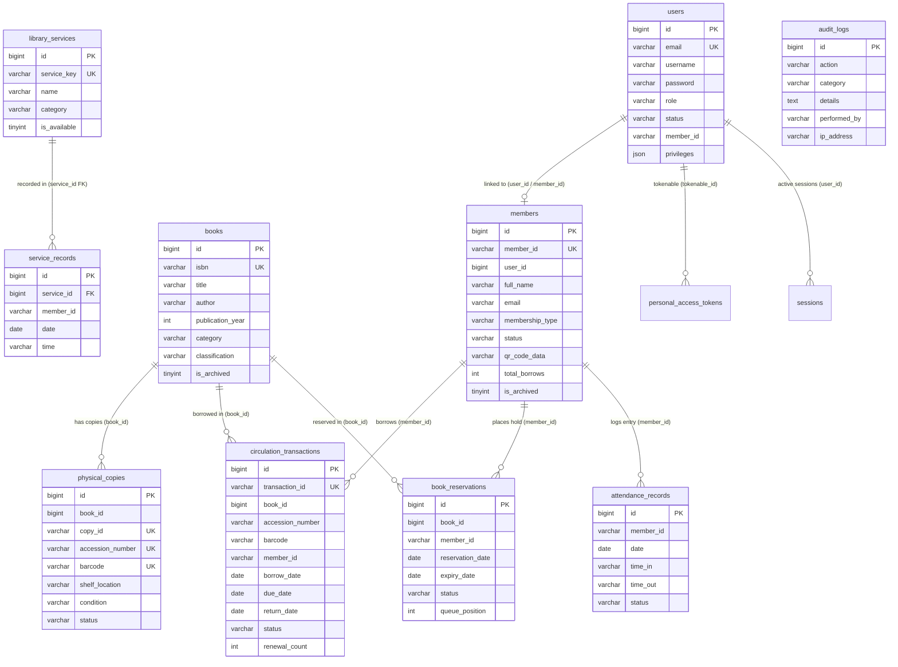

# Data Dictionary: Balingasag Public Library Management System

> **Document Type:** Database Schema Specification & Technical Data Dictionary  
> **Database Name:** `library_db`  
> **DBMS:** MySQL Community Server `8.4.3`  
> **Default Storage Engine:** `InnoDB`  
> **Default Character Set & Collation:** `utf8mb4` / `utf8mb4_unicode_ci` (`utf8mb4_0900_ai_ci`)  
> **Repository Root:** `c:\laragon\www\final-nani`  
> **Author:** Senior Database Designer & Technical Documentation Specialist  
> **Version:** 1.0.0 (Verified against live MySQL instance)  

---

## 1. Database Overview

The `library_db` database is the primary relational database for the **Balingasag Public Library Management System (BPL-LMS)**. It manages municipal library patron accounts, staff identities, bibliographic records, individual shelf copies, circulation loans, room and PC amenity usage, attendance entries, and immutable security audit logs.

### Database Metadata Summary

| Property | Value | Source / Verification Method |
| :--- | :--- | :--- |
| **Database Name** | `library_db` | Verified via `SELECT DATABASE()` |
| **RDBMS Server** | MySQL Community Server (x86_64) | Verified via `SELECT @@version` (`8.4.3`) |
| **Default Storage Engine** | `InnoDB` | Verified via `SHOW TABLE STATUS` |
| **Character Set** | `utf8mb4` | Verified via `SELECT @@character_set_database` |
| **Collation** | `utf8mb4_unicode_ci` / `utf8mb4_0900_ai_ci` | Verified via `SELECT @@collation_database` |
| **Total Tables Documented** | 20 | Verified via `SHOW TABLES` & schema dump |
| **Total Columns Documented**| 205 | Sum of all verified table attributes |
| **Security Note** | No credentials, secrets, or passwords are disclosed in this document. | Security baseline compliant |

---

## 2. Table-by-Table Documentation

---

### 2.1 `users`
**Description:** Stores internal application user accounts for administrative staff (`super_admin`, `admin`, `volunteer`) and patron portal credentials (`member`). Governs access to the web portal.

| Column Name | Data Type | Length/Precision | Nullable | Key | Default Value | Description | Constraints / Rules |
| :--- | :--- | :--- | :---: | :---: | :--- | :--- | :--- |
| `id` | `bigint unsigned` | 64-bit unsigned | No | PK | *None* | Primary synthetic identifier. | Auto-increment (`AUTO_INCREMENT`). |
| `name` | `varchar(255)` | 255 chars | No | None | *None* | Full display name of the staff or patron. | Required; validated max 255 chars. |
| `email` | `varchar(255)` | 255 chars | No | UNI | *None* | Official email address; used for login. | Unique constraint (`users_email_unique`). |
| `username` | `varchar(255)` | 255 chars | Yes | None | `NULL` | Optional unique username alias. | Unique across non-null values. |
| `email_verified_at`| `datetime` | Format: YYYY-MM-DD HH:MM:SS | Yes | None | `NULL` | Timestamp when the user verified email. | Nullable. |
| `password` | `varchar(255)` | 255 chars | No | None | *None* | Bcrypt encrypted hash of the account password. | Cost factor 12 (`BCRYPT_ROUNDS=12`). |
| `role` | `varchar(255)` | 255 chars | No | None | `'member'` | Primary security role. | Allowed: `'super_admin'`, `'admin'`, `'volunteer'`, `'member'`. |
| `status` | `varchar(255)` | 255 chars | No | None | `'active'` | Operational account status. | Allowed: `'active'`, `'inactive'`, `'suspended'`. |
| `member_id` | `varchar(255)` | 255 chars | Yes | None | `NULL` | Patron identifier linking to `members.member_id`. | Logical link to patron profile. |
| `department` | `varchar(255)` | 255 chars | Yes | None | `NULL` | Municipal library section or branch office. | Optional metadata. |
| `privileges` | `json` | Variable JSON | Yes | None | `NULL` | Custom granular operational privileges dictionary. | JSON schema for `LibrarianPrivileges`. |
| `phone` | `varchar(255)` | 255 chars | Yes | None | `NULL` | Contact telephone or mobile number. | Optional contact info. |
| `address` | `varchar(255)` | 255 chars | Yes | None | `NULL` | Residential barangay address. | Optional address. |
| `remember_token` | `varchar(255)` | 255 chars | Yes | None | `NULL` | Token for "Remember Me" persistent browser session. | Managed by Laravel session guard. |
| `created_at` | `datetime` | Format: YYYY-MM-DD HH:MM:SS | Yes | None | `NULL` | Account creation timestamp. | Populated by Eloquent ORM. |
| `updated_at` | `datetime` | Format: YYYY-MM-DD HH:MM:SS | Yes | None | `NULL` | Last modification timestamp. | Populated by Eloquent ORM. |

---

### 2.2 `members`
**Description:** Official municipal library patron registry. Contains patron biographical records, membership classification tiers, photos, and QR barcode payloads.

| Column Name | Data Type | Length/Precision | Nullable | Key | Default Value | Description | Constraints / Rules |
| :--- | :--- | :--- | :---: | :---: | :--- | :--- | :--- |
| `id` | `bigint unsigned` | 64-bit unsigned | No | PK | *None* | Primary synthetic identifier. | Auto-increment (`AUTO_INCREMENT`). |
| `user_id` | `bigint unsigned` | 64-bit unsigned | Yes | None | `NULL` | Optional link to `users.id` portal account. | Logical 1:1 foreign key. |
| `member_id` | `varchar(255)` | 255 chars | No | UNI | *None* | Official municipal patron card number (`BPL-YYYY-XXXX`). | Unique constraint (`members_member_id_unique`). |
| `first_name` | `varchar(255)` | 255 chars | Yes | None | `NULL` | Patron given name. | Max 100 chars in validation. |
| `middle_name` | `varchar(255)` | 255 chars | Yes | None | `NULL` | Patron middle name (optional). | Max 100 chars in validation. |
| `last_name` | `varchar(255)` | 255 chars | Yes | None | `NULL` | Patron family surname. | Max 100 chars in validation. |
| `suffix` | `varchar(50)` | 50 chars | Yes | None | `NULL` | Name generation suffix (Jr., Sr., III, etc.). | Max 50 chars. |
| `full_name` | `varchar(255)` | 255 chars | No | None | *None* | Concatenated patron name for display and search. | Computed from parts or explicit input. |
| `username` | `varchar(255)` | 255 chars | Yes | None | `NULL` | Patron portal login username alias. | Optional username. |
| `date_of_birth` | `date` | Format: YYYY-MM-DD | Yes | None | `NULL` | Patron birth date. | Date validation. |
| `gender` | `varchar(255)` | 255 chars | Yes | None | `NULL` | Patron gender / sex identity. | Allowed: `'Male'`, `'Female'`, `'Other'`. |
| `email` | `varchar(255)` | 255 chars | Yes | None | `NULL` | Patron email address for notifications. | Email format validated. |
| `phone` | `varchar(255)` | 255 chars | Yes | None | `NULL` | Mobile phone number for SMS/call notices. | Max 50 chars. |
| `address` | `varchar(255)` | 255 chars | Yes | None | `NULL` | Barangay, street, and municipality address. | Max 255 chars. |
| `membership_type`| `varchar(255)` | 255 chars | No | None | `'Student'` | Patron membership classification. | Allowed: `'Student'`, `'Faculty'`, `'Community'`, `'Researcher'`. |
| `status` | `varchar(255)` | 255 chars | No | None | `'active'` | Patron status. | Allowed: `'active'`, `'inactive'`, `'suspended'`. |
| `photo_url` | `longtext` | Up to 4GB text | Yes | None | `NULL` | Base64 encoded portrait or public image URL. | Unsplash fallback if omitted. |
| `qr_code_data` | `varchar(255)` | 255 chars | Yes | None | `NULL` | 2D matrix barcode payload matching `member_id`. | Used for optical camera scanners. |
| `join_date` | `date` | Format: YYYY-MM-DD | Yes | None | `NULL` | Date of registration with the library. | Defaults to `now()->toDateString()`. |
| `total_borrows` | `int` | 32-bit integer | No | None | `0` | Cumulative count of books borrowed by patron. | Incremented on loan checkouts. |
| `is_archived` | `tinyint(1)` | 1-bit boolean | No | None | `0` | Soft deletion status indicator. | `0` = Active, `1` = Archived. |
| `created_at` | `datetime` | Format: YYYY-MM-DD HH:MM:SS | Yes | None | `NULL` | Record creation timestamp. | Populated by Eloquent ORM. |
| `updated_at` | `datetime` | Format: YYYY-MM-DD HH:MM:SS | Yes | None | `NULL` | Last modification timestamp. | Populated by Eloquent ORM. |

---

### 2.3 `books`
**Description:** Master bibliographic catalog. Stores title-level metadata, classification numbers, publication details, and cover images.

| Column Name | Data Type | Length/Precision | Nullable | Key | Default Value | Description | Constraints / Rules |
| :--- | :--- | :--- | :---: | :---: | :--- | :--- | :--- |
| `id` | `bigint unsigned` | 64-bit unsigned | No | PK | *None* | Primary synthetic identifier. | Auto-increment (`AUTO_INCREMENT`). |
| `isbn` | `varchar(255)` | 255 chars | No | UNI | *None* | International Standard Book Number (ISBN-10 or 13). | Unique constraint (`books_isbn_unique`). |
| `title` | `varchar(255)` | 255 chars | No | None | *None* | Main title of the published volume. | Required; max 255 chars. |
| `subtitle` | `varchar(255)` | 255 chars | Yes | None | `NULL` | Secondary title or subtitle. | Max 255 chars. |
| `author` | `varchar(255)` | 255 chars | No | None | *None* | Primary author, editor, or corporate body. | Required; max 255 chars. |
| `publisher` | `varchar(255)` | 255 chars | Yes | None | `NULL` | Publishing house or printing imprint. | Optional text. |
| `publication_year`| `int` | 32-bit integer | Yes | None | `NULL` | Calendar year of copyright / publication. | Validated integer. |
| `edition` | `varchar(255)` | 255 chars | Yes | None | `NULL` | Edition statement (e.g., "2nd Edition"). | Optional text. |
| `language` | `varchar(255)` | 255 chars | No | None | `'English'` | Primary language of the text. | Defaults to English. |
| `description` | `text` | Up to 64KB text | Yes | None | `NULL` | Synopsis, summary, or annotations. | Text field. |
| `pages` | `int` | 32-bit integer | No | None | `0` | Number of numbered pages. | Defaults to 0. |
| `category` | `varchar(255)` | 255 chars | No | None | `'General'` | High-level library collection genre. | Defaults to 'General'. |
| `subject` | `varchar(255)` | 255 chars | Yes | None | `NULL` | Topical subject heading. | Optional text. |
| `keywords` | `text` | Up to 64KB text | Yes | None | `NULL` | Searchable keyword tags (serialized as JSON). | Cast to array in Eloquent. |
| `classification`| `varchar(255)` | 255 chars | Yes | None | `NULL` | Call number / Dewey Decimal classification. | e.g. `005.133`, `823.91`. |
| `cover_image` | `text` | Up to 64KB text | Yes | None | `NULL` | URL or base64 data for book cover artwork. | Optional image URL. |
| `is_archived` | `tinyint(1)` | 1-bit boolean | No | None | `0` | Soft deletion indicator. | `0` = Active catalog, `1` = Archived. |
| `created_at` | `datetime` | Format: YYYY-MM-DD HH:MM:SS | Yes | None | `NULL` | Record creation timestamp. | Populated by Eloquent ORM. |
| `updated_at` | `datetime` | Format: YYYY-MM-DD HH:MM:SS | Yes | None | `NULL` | Last modification timestamp. | Populated by Eloquent ORM. |

---

### 2.4 `physical_copies`
**Description:** Inventory of individual physical book copies belonging to a master title. Tracks distinct barcodes, accession numbers, conditions, and shelf availability.

| Column Name | Data Type | Length/Precision | Nullable | Key | Default Value | Description | Constraints / Rules |
| :--- | :--- | :--- | :---: | :---: | :--- | :--- | :--- |
| `id` | `bigint unsigned` | 64-bit unsigned | No | PK | *None* | Primary synthetic identifier. | Auto-increment (`AUTO_INCREMENT`). |
| `book_id` | `bigint unsigned` | 64-bit unsigned | No | None | *None* | Bibliographic record foreign key (`books.id`). | Required; logical foreign key. |
| `copy_id` | `varchar(255)` | 255 chars | No | UNI | *None* | Unique copy code (e.g., `BPL-000101-C1`). | Unique constraint (`physical_copies_copy_id_unique`). |
| `accession_number`| `varchar(255)`| 255 chars | No | UNI | *None* | Official municipal property accession number. | Unique constraint (`physical_copies_accession_number_unique`). |
| `barcode` | `varchar(255)` | 255 chars | No | UNI | *None* | Scannable Code-128 / QR barcode string. | Unique constraint (`physical_copies_barcode_unique`). |
| `shelf_location` | `varchar(255)` | 255 chars | Yes | None | `NULL` | Physical shelf location (e.g., "Stack 3B, 2nd Floor"). | Optional text. |
| `classification`| `varchar(255)` | 255 chars | Yes | None | `NULL` | Spine call number. | Inherited from `books.classification`. |
| `condition` | `varchar(255)` | 255 chars | No | None | `'Good'` | Physical item condition. | Allowed: `'Good'`, `'Fair'`, `'New'`, `'Damaged'`. |
| `status` | `varchar(255)` | 255 chars | No | None | `'Available'` | Shelf loan status. | Allowed: `'Available'`, `'Borrowed'`, `'Reserved'`, `'Lost'`, `'Under Repair'`. |
| `date_added` | `date` | Format: YYYY-MM-DD | Yes | None | `NULL` | Date copy was added to inventory. | Defaults to `now()->toDateString()`. |
| `created_at` | `datetime` | Format: YYYY-MM-DD HH:MM:SS | Yes | None | `NULL` | Record creation timestamp. | Populated by Eloquent ORM. |
| `updated_at` | `datetime` | Format: YYYY-MM-DD HH:MM:SS | Yes | None | `NULL` | Last modification timestamp. | Populated by Eloquent ORM. |

---

### 2.5 `circulation_transactions`
**Description:** Records circulation loan transactions, borrowing dates, scheduled return dates, renewals, and overdue penalty statuses.

| Column Name | Data Type | Length/Precision | Nullable | Key | Default Value | Description | Constraints / Rules |
| :--- | :--- | :--- | :---: | :---: | :--- | :--- | :--- |
| `id` | `bigint unsigned` | 64-bit unsigned | No | PK | *None* | Primary synthetic identifier. | Auto-increment (`AUTO_INCREMENT`). |
| `transaction_id`| `varchar(255)` | 255 chars | No | UNI | *None* | Unique transaction number (`BRW-2026-XXXXX`). | Unique constraint (`circulation_transactions_transaction_id_unique`). |
| `book_id` | `bigint unsigned` | 64-bit unsigned | Yes | None | `NULL` | Link to `books.id`. | Nullable on book catalog changes. |
| `book_title` | `varchar(255)` | 255 chars | No | None | *None* | Snapshot of book title at time of loan. | Preserved historically. |
| `book_author` | `varchar(255)` | 255 chars | Yes | None | `NULL` | Snapshot of author at time of loan. | Preserved historically. |
| `accession_number`| `varchar(255)`| 255 chars | No | None | *None* | Accession number of specific physical copy. | Required identifier. |
| `barcode` | `varchar(255)` | 255 chars | No | None | *None* | Scanned barcode of loaned copy. | Scanned during return desk checkout. |
| `member_id` | `varchar(255)` | 255 chars | No | None | *None* | Patron card number (`BPL-YYYY-XXXX`). | Logical link to `members.member_id`. |
| `member_name` | `varchar(255)` | 255 chars | No | None | *None* | Snapshot of patron full name at loan time. | Preserved historically. |
| `borrow_date` | `date` | Format: YYYY-MM-DD | No | None | *None* | Date book was checked out from desk. | Defaults to current date. |
| `due_date` | `date` | Format: YYYY-MM-DD | No | None | *None* | Mandated return deadline. | Calculated standard: borrow date + 7 days. |
| `return_date` | `date` | Format: YYYY-MM-DD | Yes | None | `NULL` | Actual date returned at desk. | `NULL` while loan is Active/Overdue. |
| `status` | `varchar(255)` | 255 chars | No | None | `'Active'` | Loan lifecycle status. | Allowed: `'Active'`, `'Returned'`, `'Overdue'`, `'Renewed'`, `'Pending Approval'`, `'Rejected'`. |
| `renewal_count` | `int` | 32-bit integer | No | None | `0` | Number of times loan was extended. | Max allowed: 2 extensions (+7 days each). |
| `processed_by` | `varchar(255)` | 255 chars | No | None | `'Admin'` | Staff member who authorized the transaction. | Captured from authenticated staff name. |
| `request_date` | `date` | Format: YYYY-MM-DD | Yes | None | `NULL` | Date online borrow request was lodged. | For patron portal requests. |
| `rejection_reason`| `text` | Up to 64KB text | Yes | None | `NULL` | Explanation if online request is rejected. | Optional rejection notes. |
| `created_at` | `datetime` | Format: YYYY-MM-DD HH:MM:SS | Yes | None | `NULL` | Record creation timestamp. | Populated by Eloquent ORM. |
| `updated_at` | `datetime` | Format: YYYY-MM-DD HH:MM:SS | Yes | None | `NULL` | Last modification timestamp. | Populated by Eloquent ORM. |

---

### 2.6 `book_reservations`
**Description:** Manages patron book hold requests when all copies of a desired title are currently on loan.

| Column Name | Data Type | Length/Precision | Nullable | Key | Default Value | Description | Constraints / Rules |
| :--- | :--- | :--- | :---: | :---: | :--- | :--- | :--- |
| `id` | `bigint unsigned` | 64-bit unsigned | No | PK | *None* | Primary synthetic identifier. | Auto-increment (`AUTO_INCREMENT`). |
| `book_id` | `bigint unsigned` | 64-bit unsigned | Yes | None | `NULL` | Link to reserved `books.id`. | Logical foreign key. |
| `book_title` | `varchar(255)` | 255 chars | No | None | *None* | Title of reserved book. | Required text. |
| `member_id` | `varchar(255)` | 255 chars | No | None | *None* | Patron card number (`BPL-YYYY-XXXX`). | Logical link to `members.member_id`. |
| `member_name` | `varchar(255)` | 255 chars | No | None | *None* | Patron full name. | Required text. |
| `reservation_date`| `date` | Format: YYYY-MM-DD | No | None | *None* | Date hold was placed. | Defaults to `now()->toDateString()`. |
| `expiry_date` | `date` | Format: YYYY-MM-DD | No | None | *None* | Date reservation expires if unclaimed. | Standard: +7 days, or +3 days after approval. |
| `status` | `varchar(255)` | 255 chars | No | None | `'Pending Approval'`| Reservation queue status. | Allowed: `'Pending Approval'`, `'Waiting'`, `'Ready for Pickup'`, `'Claimed'`, `'Cancelled'`, `'Expired'`, `'Rejected'`. |
| `queue_position`| `int` | 32-bit integer | No | None | `1` | FIFO queue ranking for popular titles. | Auto-sequenced based on active holds. |
| `notes` | `text` | Up to 64KB text | Yes | None | `NULL` | Patron or staff hold notes. | Optional text. |
| `created_at` | `datetime` | Format: YYYY-MM-DD HH:MM:SS | Yes | None | `NULL` | Record creation timestamp. | Populated by Eloquent ORM. |
| `updated_at` | `datetime` | Format: YYYY-MM-DD HH:MM:SS | Yes | None | `NULL` | Last modification timestamp. | Populated by Eloquent ORM. |

---

### 2.7 `attendance_records`
**Description:** Tracks physical visitor entry and exit at the library entrance. Captured via camera QR scanning or manual desk entry.

| Column Name | Data Type | Length/Precision | Nullable | Key | Default Value | Description | Constraints / Rules |
| :--- | :--- | :--- | :---: | :---: | :--- | :--- | :--- |
| `id` | `bigint unsigned` | 64-bit unsigned | No | PK | *None* | Primary synthetic identifier. | Auto-increment (`AUTO_INCREMENT`). |
| `member_id` | `varchar(255)` | 255 chars | No | None | *None* | Patron card number (`BPL-YYYY-XXXX`). | Logical link to `members.member_id`. |
| `member_name` | `varchar(255)` | 255 chars | No | None | *None* | Patron full name. | Preserved display name. |
| `membership_type`| `varchar(255)` | 255 chars | No | None | `'Student'` | Patron demographic tier. | e.g. `'Student'`, `'Faculty'`, `'Community'`. |
| `date` | `date` | Format: YYYY-MM-DD | No | None | *None* | Date of library visit. | Defaults to current date. |
| `time_in` | `varchar(255)` | 255 chars | No | None | *None* | Check-in time string (e.g., `09:15 AM`). | Captured on entry scan. |
| `time_out` | `varchar(255)` | 255 chars | Yes | None | `NULL` | Check-out time string (e.g., `11:42 AM`). | Captured on exit scan. |
| `duration` | `varchar(255)` | 255 chars | Yes | None | `NULL` | Calculated time spent (e.g., `2h 27m`). | Computed upon check-out. |
| `status` | `varchar(255)` | 255 chars | No | None | `'Inside'` | Facility status. | Allowed: `'Inside'`, `'Completed'`. |
| `notes` | `text` | Up to 64KB text | Yes | None | `NULL` | Optional visit notes or purpose. | Optional text. |
| `edited_by` | `varchar(255)` | 255 chars | Yes | None | `NULL` | Name of staff who corrected record. | Audit trail for manual adjustments. |
| `edit_reason` | `text` | Up to 64KB text | Yes | None | `NULL` | Mandated administrative reason for edit. | Required when updating attendance. |
| `edited_at` | `datetime` | Format: YYYY-MM-DD HH:MM:SS | Yes | None | `NULL` | Timestamp of administrative correction. | Captured on update. |
| `created_at` | `datetime` | Format: YYYY-MM-DD HH:MM:SS | Yes | None | `NULL` | Record creation timestamp. | Populated by Eloquent ORM. |
| `updated_at` | `datetime` | Format: YYYY-MM-DD HH:MM:SS | Yes | None | `NULL` | Last modification timestamp. | Populated by Eloquent ORM. |

---

### 2.8 `library_services`
**Description:** Catalog of official public municipal library services offered (Internet, photocopying, research assistance, study rooms).

| Column Name | Data Type | Length/Precision | Nullable | Key | Default Value | Description | Constraints / Rules |
| :--- | :--- | :--- | :---: | :---: | :--- | :--- | :--- |
| `id` | `bigint unsigned` | 64-bit unsigned | No | PK | *None* | Primary synthetic identifier. | Auto-increment (`AUTO_INCREMENT`). |
| `service_key` | `varchar(255)` | 255 chars | No | UNI | *None* | Unique programmatic slug key. | Unique constraint (`library_services_service_key_unique`). |
| `name` | `varchar(255)` | 255 chars | No | None | *None* | Display name of the service. | e.g. "Public Computer & Internet Access". |
| `category` | `varchar(255)` | 255 chars | No | None | *None* | Service grouping. | e.g. "Technology", "Reference", "Facilities". |
| `description` | `text` | Up to 64KB text | Yes | None | `NULL` | Full description of service terms. | Optional text. |
| `icon_name` | `varchar(255)` | 255 chars | No | None | `'Search'` | Lucide icon identifier. | Defaults to `'Search'`. |
| `is_available` | `tinyint(1)` | 1-bit boolean | No | None | `1` | Operational availability toggle. | `1` = Available, `0` = Suspended. |
| `created_at` | `timestamp` | Format: YYYY-MM-DD HH:MM:SS | Yes | None | `NULL` | Record creation timestamp. | Populated by Eloquent ORM. |
| `updated_at` | `timestamp` | Format: YYYY-MM-DD HH:MM:SS | Yes | None | `NULL` | Last modification timestamp. | Populated by Eloquent ORM. |

---

### 2.9 `service_records`
**Description:** Operational log tracking patron utilization of specific library services and facilities.

| Column Name | Data Type | Length/Precision | Nullable | Key | Default Value | Description | Constraints / Rules |
| :--- | :--- | :--- | :---: | :---: | :--- | :--- | :--- |
| `id` | `bigint unsigned` | 64-bit unsigned | No | PK | *None* | Primary synthetic identifier. | Auto-increment (`AUTO_INCREMENT`). |
| `service_id` | `bigint unsigned` | 64-bit unsigned | Yes | MUL | `NULL` | Foreign key referencing `library_services.id`. | Foreign Key (`service_records_service_id_foreign`) ON DELETE SET NULL. |
| `service_name` | `varchar(255)` | 255 chars | No | None | *None* | Name of service logged. | Preserved historically. |
| `member_id` | `varchar(255)` | 255 chars | No | None | *None* | Patron card number (`BPL-YYYY-XXXX`). | Logical link to `members.member_id`. |
| `member_name` | `varchar(255)` | 255 chars | No | None | *None* | Patron full name. | Preserved historically. |
| `date` | `date` | Format: YYYY-MM-DD | No | None | *None* | Date service was rendered. | Defaults to `now()->toDateString()`. |
| `time` | `varchar(255)` | 255 chars | No | None | *None* | Time service was rendered (e.g., `10:30 AM`). | Captured on submit. |
| `notes` | `text` | Up to 64KB text | Yes | None | `NULL` | Details (e.g., workstation #3, 5 pages printed). | Optional text. |
| `recorded_by` | `varchar(255)` | 255 chars | No | None | `'Staff'` | Staff member who logged the service usage. | Captured from authenticated staff. |
| `created_at` | `timestamp` | Format: YYYY-MM-DD HH:MM:SS | Yes | None | `NULL` | Record creation timestamp. | Populated by Eloquent ORM. |
| `updated_at` | `timestamp` | Format: YYYY-MM-DD HH:MM:SS | Yes | None | `NULL` | Last modification timestamp. | Populated by Eloquent ORM. |

---

### 2.10 `audit_logs`
**Description:** Immutable security and administrative audit trail recording all critical system mutations.

| Column Name | Data Type | Length/Precision | Nullable | Key | Default Value | Description | Constraints / Rules |
| :--- | :--- | :--- | :---: | :---: | :--- | :--- | :--- |
| `id` | `bigint unsigned` | 64-bit unsigned | No | PK | *None* | Primary synthetic identifier. | Auto-increment (`AUTO_INCREMENT`). |
| `action` | `varchar(255)` | 255 chars | No | None | *None* | Action verb (e.g., `USER_LOGIN`, `Book Borrowed`).| Standard action codes. |
| `category` | `varchar(255)` | 255 chars | No | None | *None* | Functional module domain. | e.g. `'Admin'`, `'Circulation'`, `'Books'`, `'Members'`. |
| `details` | `text` | Up to 64KB text | No | None | *None* | Human-readable explanation of the event. | Full narrative log. |
| `performed_by` | `varchar(255)` | 255 chars | No | None | `'System'` | Name of staff user or system process. | Required field. |
| `ip_address` | `varchar(255)` | 255 chars | Yes | None | `NULL` | Client IP address of requesting browser. | Captured from `$request->ip()`. |
| `created_at` | `datetime` | Format: YYYY-MM-DD HH:MM:SS | Yes | None | `NULL` | Event timestamp. | Populated by Eloquent ORM. |
| `updated_at` | `datetime` | Format: YYYY-MM-DD HH:MM:SS | Yes | None | `NULL` | Record timestamp. | Populated by Eloquent ORM. |

---

### 2.11 `notifications`
**Description:** System alerts, borrow reminders, hold notices, and administrative notifications targeted to roles or individual patrons.

| Column Name | Data Type | Length/Precision | Nullable | Key | Default Value | Description | Constraints / Rules |
| :--- | :--- | :--- | :---: | :---: | :--- | :--- | :--- |
| `id` | `bigint unsigned` | 64-bit unsigned | No | PK | *None* | Primary synthetic identifier. | Auto-increment (`AUTO_INCREMENT`). |
| `title` | `varchar(255)` | 255 chars | No | None | *None* | Notification header title. | Required text. |
| `message` | `text` | Up to 64KB text | No | None | *None* | Body message text. | Required text. |
| `type` | `varchar(255)` | 255 chars | No | None | `'info'` | Visual alert severity. | Allowed: `'info'`, `'warning'`, `'success'`, `'alert'`. |
| `read` | `tinyint(1)` | 1-bit boolean | No | None | `0` | Read receipt flag. | `0` = Unread, `1` = Read. |
| `target_role` | `varchar(255)` | 255 chars | Yes | None | `NULL` | Target role audience. | e.g. `'all'`, `'super_admin'`, `'admin'`. |
| `target_member_id`| `varchar(255)`| 255 chars | Yes | None | `NULL` | Specific recipient patron `member_id`. | Logical link to `members.member_id`. |
| `created_at` | `datetime` | Format: YYYY-MM-DD HH:MM:SS | Yes | None | `NULL` | Notification creation timestamp. | Populated by Eloquent ORM. |
| `updated_at` | `datetime` | Format: YYYY-MM-DD HH:MM:SS | Yes | None | `NULL` | Last modification timestamp. | Populated by Eloquent ORM. |

---

### 2.12 `personal_access_tokens`
**Description:** Laravel Sanctum bearer tokens authenticating API requests.

| Column Name | Data Type | Length/Precision | Nullable | Key | Default Value | Description | Constraints / Rules |
| :--- | :--- | :--- | :---: | :---: | :--- | :--- | :--- |
| `id` | `bigint unsigned` | 64-bit unsigned | No | PK | *None* | Primary synthetic identifier. | Auto-increment (`AUTO_INCREMENT`). |
| `tokenable_type`| `varchar(255)` | 255 chars | No | None | *None* | Polymorphic model class (`App\Models\User`). | Required. |
| `tokenable_id` | `bigint unsigned` | 64-bit unsigned | No | None | *None* | Polymorphic model identifier (`users.id`). | Required. |
| `name` | `text` | Variable text | No | None | *None* | Token name (e.g., `bpl-staff-portal`). | Required. |
| `token` | `varchar(255)` | 255 chars | No | UNI | *None* | SHA-256 hashed token string. | Unique constraint (`personal_access_tokens_token_unique`). |
| `abilities` | `text` | Variable text | Yes | None | `NULL` | Token permissions (e.g., `["*"]`). | Serialized JSON array. |
| `last_used_at` | `datetime` | Format: YYYY-MM-DD HH:MM:SS | Yes | None | `NULL` | Timestamp of last API interaction. | Updated by Sanctum. |
| `expires_at` | `datetime` | Format: YYYY-MM-DD HH:MM:SS | Yes | None | `NULL` | Expiration timestamp. | Nullable. |
| `created_at` | `datetime` | Format: YYYY-MM-DD HH:MM:SS | Yes | None | `NULL` | Creation timestamp. | Populated by Sanctum. |
| `updated_at` | `datetime` | Format: YYYY-MM-DD HH:MM:SS | Yes | None | `NULL` | Modification timestamp. | Populated by Sanctum. |

---

### 2.13 `password_reset_tokens`
**Description:** Laravel authentication password reset verification tokens.

| Column Name | Data Type | Length/Precision | Nullable | Key | Default Value | Description | Constraints / Rules |
| :--- | :--- | :--- | :---: | :---: | :--- | :--- | :--- |
| `email` | `varchar(255)` | 255 chars | No | PK | *None* | User email requesting password reset. | Primary Key (`PRIMARY KEY (email)`). |
| `token` | `varchar(255)` | 255 chars | No | None | *None* | Password reset security hash. | Required string. |
| `created_at` | `datetime` | Format: YYYY-MM-DD HH:MM:SS | Yes | None | `NULL` | Token generation timestamp. | Used for timeout expiration. |

---

### 2.14 `sessions`
**Description:** Database session driver storage when configured in `backend/.env`.

| Column Name | Data Type | Length/Precision | Nullable | Key | Default Value | Description | Constraints / Rules |
| :--- | :--- | :--- | :---: | :---: | :--- | :--- | :--- |
| `id` | `varchar(255)` | 255 chars | No | PK | *None* | Unique session identifier hash. | Primary Key (`PRIMARY KEY (id)`). |
| `user_id` | `bigint unsigned` | 64-bit unsigned | Yes | None | `NULL` | Foreign key referencing authenticated `users.id`. | Nullable for guests. |
| `ip_address` | `varchar(255)` | 255 chars | Yes | None | `NULL` | Client IP address. | IPv4/IPv6 address. |
| `user_agent` | `text` | Up to 64KB text | Yes | None | `NULL` | Client browser user agent string. | Optional metadata. |
| `payload` | `text` | Up to 64KB text | No | None | *None* | Serialized session data. | Required text. |
| `last_activity` | `int` | 32-bit integer | No | None | *None* | Unix epoch timestamp of last user interaction. | Used for session expiry. |

---

### 2.15 `cache`
**Description:** Application key-value cache store for high-frequency queries.

| Column Name | Data Type | Length/Precision | Nullable | Key | Default Value | Description | Constraints / Rules |
| :--- | :--- | :--- | :---: | :---: | :--- | :--- | :--- |
| `key` | `varchar(255)` | 255 chars | No | PK | *None* | Unique cache key. | Primary Key (`PRIMARY KEY (key)`). |
| `value` | `text` | Up to 64KB text | No | None | *None* | Serialized cache data payload. | Required text. |
| `expiration` | `int` | 32-bit integer | No | None | *None* | Unix epoch expiration timestamp. | Required integer. |

---

### 2.16 `cache_locks`
**Description:** Atomic distributed locks preventing race conditions during concurrent operations.

| Column Name | Data Type | Length/Precision | Nullable | Key | Default Value | Description | Constraints / Rules |
| :--- | :--- | :--- | :---: | :---: | :--- | :--- | :--- |
| `key` | `varchar(255)` | 255 chars | No | PK | *None* | Lock resource key identifier. | Primary Key (`PRIMARY KEY (key)`). |
| `owner` | `varchar(255)` | 255 chars | No | None | *None* | Process or job owning the lock token. | Required string. |
| `expiration` | `int` | 32-bit integer | No | None | *None* | Unix epoch lock release timestamp. | Required integer. |

---

### 2.17 `jobs`
**Description:** Queue engine table for asynchronous background jobs.

| Column Name | Data Type | Length/Precision | Nullable | Key | Default Value | Description | Constraints / Rules |
| :--- | :--- | :--- | :---: | :---: | :--- | :--- | :--- |
| `id` | `bigint unsigned` | 64-bit unsigned | No | PK | *None* | Primary synthetic identifier. | Auto-increment (`AUTO_INCREMENT`). |
| `queue` | `varchar(255)` | 255 chars | No | None | *None* | Name of queue partition (e.g. `'default'`). | Required string. |
| `payload` | `text` | Up to 64KB text | No | None | *None* | Serialized job closure and arguments. | Required text. |
| `attempts` | `int` | 32-bit integer | No | None | *None* | Execution attempt counter. | Required integer. |
| `reserved_at` | `int` | 32-bit integer | Yes | None | `NULL` | Unix timestamp when worker reserved job. | Nullable integer. |
| `available_at` | `int` | 32-bit integer | No | None | *None* | Unix timestamp when job is eligible to run. | Required integer. |
| `created_at` | `int` | 32-bit integer | No | None | *None* | Unix timestamp of job dispatch. | Required integer. |

---

### 2.18 `job_batches`
**Description:** Tracks batches of queued jobs executing concurrently.

| Column Name | Data Type | Length/Precision | Nullable | Key | Default Value | Description | Constraints / Rules |
| :--- | :--- | :--- | :---: | :---: | :--- | :--- | :--- |
| `id` | `varchar(255)` | 255 chars | No | PK | *None* | Batch UUID string. | Primary Key (`PRIMARY KEY (id)`). |
| `name` | `varchar(255)` | 255 chars | No | None | *None* | Batch descriptive name. | Required string. |
| `total_jobs` | `int` | 32-bit integer | No | None | *None* | Total job count in batch. | Required integer. |
| `pending_jobs` | `int` | 32-bit integer | No | None | *None* | Jobs remaining to execute. | Required integer. |
| `failed_jobs` | `int` | 32-bit integer | No | None | *None* | Jobs that encountered exceptions. | Required integer. |
| `failed_job_ids`| `text` | Up to 64KB text | No | None | *None* | JSON array of failed job IDs. | Required text. |
| `options` | `text` | Up to 64KB text | Yes | None | `NULL` | Serialized batch callback handlers. | Optional text. |
| `cancelled_at` | `int` | 32-bit integer | Yes | None | `NULL` | Unix timestamp if batch was cancelled. | Nullable integer. |
| `created_at` | `int` | 32-bit integer | No | None | *None* | Unix creation timestamp. | Required integer. |
| `finished_at` | `int` | 32-bit integer | Yes | None | `NULL` | Unix completion timestamp. | Nullable integer. |

---

### 2.19 `failed_jobs`
**Description:** Dead-letter table recording background queue jobs that failed permanently.

| Column Name | Data Type | Length/Precision | Nullable | Key | Default Value | Description | Constraints / Rules |
| :--- | :--- | :--- | :---: | :---: | :--- | :--- | :--- |
| `id` | `bigint unsigned` | 64-bit unsigned | No | PK | *None* | Primary synthetic identifier. | Auto-increment (`AUTO_INCREMENT`). |
| `uuid` | `varchar(255)` | 255 chars | No | UNI | *None* | Unique job failure UUID. | Unique constraint (`failed_jobs_uuid_unique`). |
| `connection` | `varchar(255)` | 255 chars | No | None | *None* | Queue connection driver. | e.g. `'database'`. |
| `queue` | `varchar(255)` | 255 chars | No | None | *None* | Queue name. | e.g. `'default'`. |
| `payload` | `text` | Up to 64KB text | No | None | *None* | Serialized job payload. | Required text. |
| `exception` | `text` | Up to 64KB text | No | None | *None* | Complete exception stack trace. | Required text. |
| `failed_at` | `datetime` | Format: YYYY-MM-DD HH:MM:SS | No | None | `CURRENT_TIMESTAMP` | Failure occurrence timestamp. | Generated default (`DEFAULT_GENERATED`). |

---

### 2.20 `migrations`
**Description:** Internal migration ledger tracking executed database migration files.

| Column Name | Data Type | Length/Precision | Nullable | Key | Default Value | Description | Constraints / Rules |
| :--- | :--- | :--- | :---: | :---: | :--- | :--- | :--- |
| `id` | `bigint unsigned` | 64-bit unsigned | No | PK | *None* | Migration sequence identifier. | Auto-increment (`AUTO_INCREMENT`). |
| `migration` | `varchar(255)` | 255 chars | No | None | *None* | Name of executed migration file. | Required string. |
| `batch` | `int` | 32-bit integer | No | None | *None* | Migration execution batch number. | Integer counter. |

---

## 3. Table Relationships

### 3.1 Verified Relational Matrix

| Parent Table | Parent Column | Child Table | Child Column | Relationship | Enforcement Level | Delete / Update Rule |
| :--- | :--- | :--- | :--- | :---: | :---: | :--- |
| `library_services` | `id` | `service_records` | `service_id` | One-to-Many | **Database FK** (`service_records_service_id_foreign`) | `ON DELETE SET NULL` / `ON UPDATE RESTRICT` |
| `users` | `id` | `members` | `user_id` | One-to-One | **Application (Eloquent)** (`Member::user()`) | Inferred from code (`belongsTo`) |
| `books` | `id` | `physical_copies` | `book_id` | One-to-Many | **Application (Eloquent)** (`Book::copies()`) | Inferred from code (`hasMany`) |
| `books` | `id` | `circulation_transactions`| `book_id` | One-to-Many | **Application (Eloquent)** (`CirculationTransaction::book()`) | Inferred from code (`belongsTo`) |
| `members` | `member_id` | `circulation_transactions`| `member_id` | One-to-Many | **Application (Eloquent)** (`CirculationTransaction::member()`) | Inferred from code (`belongsTo`) |
| `books` | `id` | `book_reservations` | `book_id` | One-to-Many | **Application (Eloquent)** (`BookReservation::book()`) | Inferred from code (`belongsTo`) |
| `members` | `member_id` | `book_reservations` | `member_id` | One-to-Many | **Application (Eloquent)** (`BookReservation::member()`) | Inferred from code (`belongsTo`) |
| `members` | `member_id` | `attendance_records` | `member_id` | One-to-Many | **Application (Eloquent)** (`AttendanceRecord::member()`) | Inferred from code (`belongsTo`) |
| `users` | `member_id` | `members` | `member_id` | One-to-One | **Application (Logical)** (`User::member()`) | Inferred from code (`hasOne`) |
| `users` | `id` | `sessions` | `user_id` | One-to-Many | **Application (Laravel)** | Session cleanup on logout |

---

## 4. Entity Relationship Diagram

---

## 5. Important Data Rules and Lifecycle

### 5.1 Business Data Constraints
- **Patron Identifier Format:** `BPL-YYYY-XXXX` (e.g., `BPL-2026-0001`). Generated sequentially by year and count.
- **Physical Copy Barcode & Accession:** Format `BPL-XXXXXX` (e.g., `BPL-000101`). Unique per copy.
- **Circulation Loan Identifier:** Format `BRW-YYYY-XXXXX` (e.g., `BRW-2026-00001`).
- **Maximum Concurrent Loans:** 3 books per patron. Enforced in `CirculationController::borrow()`.
- **Loan Duration:** 7 calendar days standard.
- **Overdue Penalty Rate:** ₱10.00 per late day, calculated at the circulation return desk.
- **Maximum Extensions:** 2 renewals (+7 days each) allowed per active loan.

### 5.2 Record Lifecycle & Soft Deletion

| Entity | Creation Trigger | Modification Trigger | Archival / Soft Delete | Permanent Deletion |
| :--- | :--- | :--- | :--- | :--- |
| **`books`** | Catalog form / Excel import | Metadata update | `is_archived = 1` | `DELETE /api/books/{id}` (Archive view) |
| **`physical_copies`** | Auto-created with Book | Condition / Shelf update | Follows parent book | Destroyed with parent book |
| **`members`** | Registration form / Excel import | Contact / Tier update | `is_archived = 1` | `DELETE /api/members/{id}` (Archive view) |
| **`circulation_transactions`** | Desk barcode checkout | Renewed / Returned | Never soft-deleted | Preserved for municipal auditing |
| **`attendance_records`** | QR camera check-in scan | Checkout / Staff edit with reason | Retained for NLP stats | Retention policy (30/90 days purge) |
| **`audit_logs`** | Automatic event triggers | **Immutable** (No updates) | Retained indefinitely | Super Admin purge tool |

---

## 6. Data Dictionary Summary

The following metrics have been calculated directly from the inspected `library_db` schema:

- **Total Documented Application & System Tables:** `20`
- **Total Documented Columns:** `205`
- **Tables with Explicit Primary Keys:** `20` (100% of tables)
- **Tables with Database-Enforced Foreign Keys:** `1` (`service_records` references `library_services.id`)
- **Tables with Application-Enforced (Eloquent) Relationships:** `8` (`members`, `books`, `physical_copies`, `circulation_transactions`, `book_reservations`, `attendance_records`, `users`, `notifications`)
- **Tables with no explicit relationships (standalone system/auth queues):** `11` (`audit_logs`, `personal_access_tokens`, `password_reset_tokens`, `sessions`, `cache`, `cache_locks`, `jobs`, `job_batches`, `failed_jobs`, `migrations`)
- **Tables Containing Sensitive Credentials or Identifying Data:**
  - `users` (`password`, `remember_token`)
  - `personal_access_tokens` (`token` SHA-256 hash)
  - `password_reset_tokens` (`token` hash)
  - `sessions` (`payload` session data)
  - `members` (demographics, phone, address, birth dates)
