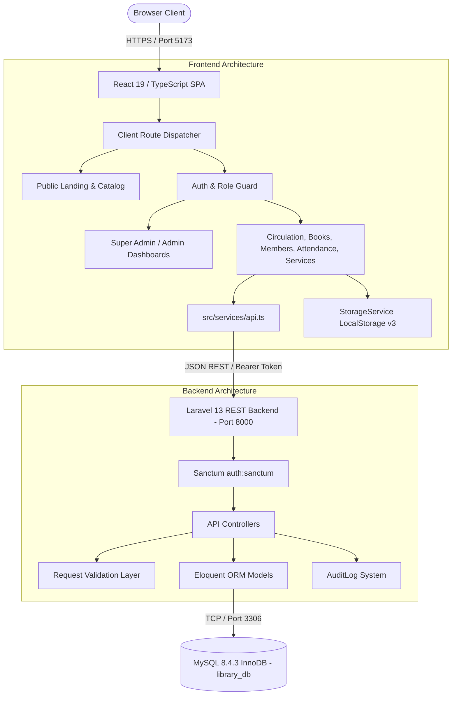
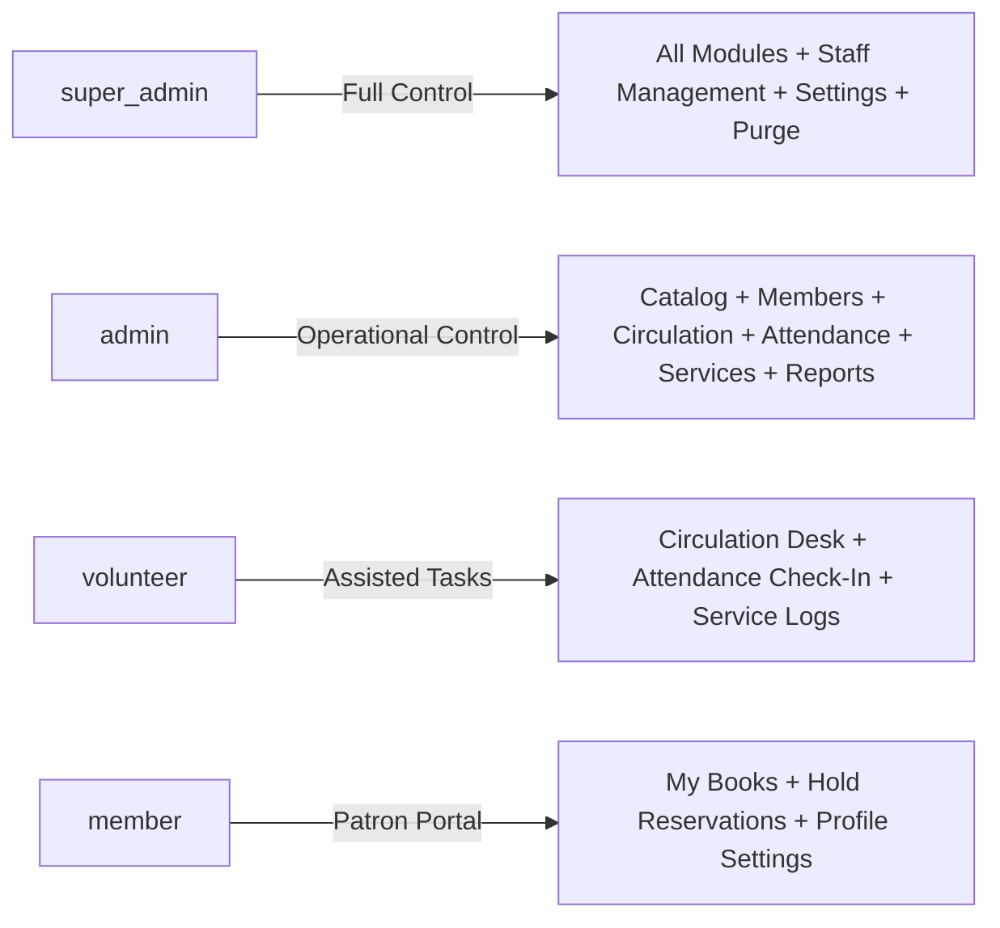
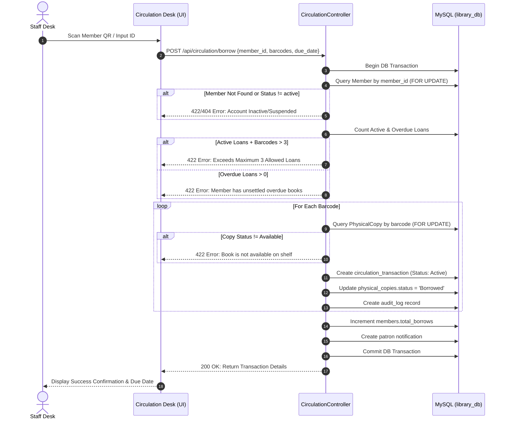

# Project Context: Balingasag Public Library Management System

> **Document Type:** Technical System Architecture & Project Context Specification  
> **Target System:** Balingasag Public Library Management System (Municipality of Balingasag, Misamis Oriental)  
> **Author:** Senior Software Architect, System Analyst & Frontend/Backend Quality Engineer  
> **Version:** 1.0.0 (Production Verified)  
> **Last Updated:** October 2026  
> **Repository Root:** `c:\laragon\www\final-nani`  

---

## 1. Project Overview

### 1.1 Official Project Name
**Balingasag Public Library Management System (BPL-LMS)**  
*Affiliated with the National Library of the Philippines (NLP) — Municipal Government of Balingasag, Province of Misamis Oriental.*

### 1.2 Purpose and Background
The Balingasag Public Library is a municipal institution located inside the **Balay Silangan Municipal Compound, Barangay Poblacion, Balingasag, Misamis Oriental**. Established in 1994, the library serves readers, elementary and secondary students, university researchers, educators, and citizens across the municipality's 36 barangays.

Prior to the deployment of this automated system, library personnel relied on manual paper-based logbooks for patron attendance, card catalog drawers for book lookups, and manual circulation ledgers for book checkouts and returns. This created significant operational challenges:
- High administrative overhead and human error during patron registration.
- Inability to track real-time book availability, shelf location, and physical copy accession numbers.
- Unmonitored overdue loans, missing lost-book tracking, and inconsistent penalty enforcement.
- Congestion at the circulation desk during peak school dismissal hours.
- Lack of digital reporting for municipal administrators and NLP statistical compliance.

The **BPL-LMS** provides an end-to-end, unified digital management platform encompassing patron identity management with QR code cards, multi-copy book cataloging, circulation loan management, real-time patron attendance scanning, municipal community services tracking, and role-based staff administration.

### 1.3 Target Users and Stakeholders
1. **Super Administrator (Head Librarian / Municipal IT Administrator):** Complete governance over all system operations, administrator account provisioning, operational privilege delegation, system configuration, audit review, and analytics.
2. **Administrator (Librarian Staff):** Day-to-day library operations including book cataloging, member registration, circulation borrowing/returns, attendance monitoring, and service logging.
3. **Volunteer (Community Helpers & Student Assistants):** Restricted operational accounts with configurable permissions (by default restricted from catalog inventory modifications and financial/administrative reporting).
4. **Member (Registered Library Patrons):** Students, faculty members, researchers, and community citizens possessing a unique `BPL-YYYY-XXXX` identifier and digital QR membership card for self-service lookups, personal borrow histories, and book hold reservations.
5. **General Public / Citizens:** Public landing page visitors discovering library hours, amenities, physical address, published catalog titles, and real-time operational statistics.

### 1.4 Scope and Boundaries
- **In Scope:**
  - Secure staff authentication via Laravel Sanctum bearer tokens with role-based dashboard gating.
  - Public-facing showcase with authentic photographic imagery of the Balingasag library building, catalog discovery, and public stats.
  - Multi-copy book cataloging supporting ISBN, Dewey/custom classification, barcodes, shelf locations, and conditions.
  - Excel/CSV bulk import engines with dual-mode validation (`all_or_nothing` vs `skip_errors`) for books and members.
  - Patron registration with QR code data generation, identity photo capture, and printable membership cards.
  - Circulation desk operations: multi-barcode batch borrowing, return processing with automatic overdue penalty calculation (₱10/day), loan renewals, and hold reservations.
  - QR barcode attendance logging tracking real-time facility occupancy (`Inside` vs `Completed`).
  - Municipal library services logging (Internet access, photocopying, reference research, study spaces).
  - Immutable system-wide audit logging and notification routing.
- **Out of Scope / Non-Goals:**
  - Self-service public member self-registration without librarian review (patron accounts are administrator-governed to maintain municipal records integrity).
  - Online payment gateway processing (fines are recorded and settled physically at the municipal library circulation desk).

---

## 2. Technology Stack

| Layer / Role | Technology | Version | Purpose in BPL-LMS |
| :--- | :--- | :--- | :--- |
| **Frontend Framework** | **React** | `19.2.8` | Declarative component UI library for reactive single-page application rendering. |
| **Frontend Language** | **TypeScript** | `~6.0.2` | Strict compile-time type safety across data contracts, components, and API services. |
| **Build Tool & Dev Server** | **Vite** | `8.2.2` | High-speed frontend bundling, hot module replacement (HMR), and asset pipeline. |
| **CSS & Design System** | **Tailwind CSS** + Custom CSS | `4.3.3` | Utility-first CSS engine integrated via `@tailwindcss/vite`, coupled with comprehensive BPL green design tokens. |
| **Icons & Visual Language**| **Lucide React** | `1.38.0` | High-consistency SVG iconography for navigation, statuses, and operational controls. |
| **QR Code Scanning** | **html5-qrcode** | `2.3.8` | Hardware camera stream scanner for patron QR cards and book barcodes. |
| **QR Code Generation** | **qrcode** | `1.5.4` | Client-side 2D matrix barcode rendering for digital member identification cards. |
| **Spreadsheet Processing**| **xlsx (SheetJS)** | `0.18.5` | Client-side spreadsheet parsing and generation for bulk catalog and member templates. |
| **Toasts & Notifications**| **Sonner** / Custom Toast | `2.0.8` | Lightweight non-blocking alert toasts for asynchronous operational feedback. |
| **Backend Framework** | **Laravel** | `13.17.x` (`^13`) | Robust MVC RESTful web service backend, Eloquent ORM, request routing, and controllers. |
| **Backend Language** | **PHP** | `8.4.3` (`^8.3`) | Server-side execution environment running with JIT and strict type declarations. |
| **API Authentication** | **Laravel Sanctum** | `^4.0` | Token-based SPA and API authentication issuing bearer tokens for authenticated staff. |
| **Database Management** | **MySQL Community Server**| `8.4.3` | Relational storage engine (`InnoDB`, `utf8mb4_unicode_ci`) storing application tables and audit trails. |
| **Local Web Stack** | **Laragon** | `6.0.x` | Windows-based local development environment bundling Apache/Nginx, MySQL, and PHP CLI. |
| **Process Orchestration** | **concurrently** | `10.0.6` | Simultaneous execution of Vite frontend (`localhost:5173`) and Artisan API (`127.0.0.1:8000`). |

---

## 3. System Architecture

The BPL-LMS is structured as a decoupled, modern client-server Single-Page Application (SPA) communicating over a secure JSON REST API.



### 3.1 Frontend Architecture
- **State Management & Data Layer:** Frontend views consume data through [`src/services/api.ts`](file:///c:/laragon/www/final-nani/src/services/api.ts). An optimistic caching layer in [`src/utils/storage.ts`](file:///c:/laragon/www/final-nani/src/utils/storage.ts) provides instantaneous page responsiveness and resilient offline fallback, synchronizing with the MySQL backend via background promises.
- **Context Providers:**
  - `ActionLoadingContext`: Provides accessible, non-blocking modal loaders and progress indicators for long-running batch transactions.
  - `BreadcrumbContext`: Synchronizes hierarchical deep links and section subtitles across staff sub-views.

### 3.2 Authentication & Token Flow
1. User enters credentials (Email/Username and Password) on [`LoginPage.tsx`](file:///c:/laragon/www/final-nani/src/components/auth/LoginPage.tsx).
2. Frontend sends `POST /api/login` containing `{ identifier, password }`.
3. Backend validates status (denying `inactive` or `suspended` users) and verifies Bcrypt password hash.
4. Old tokens are purged (`$user->tokens()->delete()`) ensuring single-session token discipline; a fresh Sanctum token (`bpl-staff-portal`) is issued.
5. The token is stored in client browser `localStorage` as `bpl_auth_token` and automatically attached as an `Authorization: Bearer <token>` header to all subsequent API requests.
6. On application boot, `App.tsx` calls `GET /api/me` to authenticate the user session server-side before rendering dashboard destinations.

---

## 4. User Roles and Permissions

The system implements strict Role-Based Access Control (RBAC) across 4 defined user roles:



### 4.1 Role Matrix

| Module / Action | `super_admin` | `admin` | `volunteer` | `member` |
| :--- | :---: | :---: | :---: | :---: |
| **Public Landing & Catalog** | Read | Read | Read | Read |
| **Circulation Loans & Returns** | Full | Full | Full (Desk) | Blocked (Staff only) |
| **Catalog Management (Books & Copies)** | Full | Full | Blocked | View Catalog Only |
| **Member Registration & Cards** | Full | Full | View & Search Only | Blocked |
| **Attendance Scanning (Check-In/Out)** | Full | Full | Full | View Own History |
| **Library Services Usage Log** | Full | Full | Full | View Own Usage |
| **Statistical Reports & CSV Exports** | Full | Full | Blocked | Blocked |
| **Staff Accounts & Privileges** | Full | Blocked | Blocked | Blocked |
| **System Audit Logs** | Full | Blocked | Blocked | Blocked |
| **Database Backups & Maintenance** | Full | Blocked | Blocked | Blocked |
| **Hold Reservations (Placement)** | Staff Override| Staff Override| Staff Override| Place & Cancel Own |

### 4.2 Granular Librarian Privileges
For fine-grained operational control, the system persists a `privileges` JSON column on the `users` table:
- `circulationDesk`: Daily loans, check-ins, barcode returns, renewals.
- `inventoryManagement`: Book creation, physical copy barcodes, catalog archiving.
- `memberManagement`: Patron account registration, status updates, card generation.
- `servicesManagement`: Attendance tracking and municipal service usage logging.
- `reportsExport`: Excel/PDF generation and statistical ledger export.
- `auditView`: Viewing immutable administrative audit logs and staff security events.

---

## 5. System Modules and Features

### 5.1 Public Portal & Catalog Discovery
- **Components:** [`LandingPage.tsx`](file:///c:/laragon/www/final-nani/src/components/public/LandingPage.tsx), [`HeroSection.tsx`](file:///c:/laragon/www/final-nani/src/components/public/HeroSection.tsx), [`AboutSection.tsx`](file:///c:/laragon/www/final-nani/src/components/public/AboutSection.tsx), [`GallerySection.tsx`](file:///c:/laragon/www/final-nani/src/components/public/GallerySection.tsx).
- **Backend Endpoints:** `GET /api/public-stats`, `GET /api/books`.
- **Functionality:** Features authentic photographic imagery of the Balingasag Municipal Library compound (`/balingasag-library-bg.jpg`), facility hours, location in Poblacion, National Library of the Philippines affiliation, live book count, and real-time active patron stats.

### 5.2 Authentication & Profile Security
- **Components:** [`LoginPage.tsx`](file:///c:/laragon/www/final-nani/src/components/auth/LoginPage.tsx), [`LogoutModal.tsx`](file:///c:/laragon/www/final-nani/src/components/auth/LogoutModal.tsx), [`ProfileSettingsView.tsx`](file:///c:/laragon/www/final-nani/src/components/profile/ProfileSettingsView.tsx).
- **Backend Endpoints:** `POST /api/login`, `POST /api/logout`, `GET /api/me`, `PUT /api/profile`, `POST /api/change-password`.
- **Functionality:** Pine-green municipal branding, password visibility toggle, accessible loading overlays, Sanctum token issuance, session cleanup on exit, and self-service password modification with confirmation validation.

### 5.3 Book Catalog & Physical Copy Inventory
- **Components:** [`BookList.tsx`](file:///c:/laragon/www/final-nani/src/components/books/BookList.tsx), [`AddBookModal.tsx`](file:///c:/laragon/www/final-nani/src/components/books/AddBookModal.tsx), [`BulkImportModal.tsx`](file:///c:/laragon/www/final-nani/src/components/books/BulkImportModal.tsx).
- **Backend Endpoints:** `GET /api/books`, `POST /api/books`, `GET /api/books/{id}`, `PUT /api/books/{id}`, `DELETE /api/books/{id}`, `GET /api/copies/barcode/{barcode}`, `GET /api/books/import/template`, `POST /api/books/import/validate`, `POST /api/books/import`.
- **Database Tables:** `books`, `physical_copies`.
- **Functionality:** Dual-entity architecture separating bibliographic metadata (`books`) from individual shelf copies (`physical_copies`) with distinct accession numbers, barcodes, shelf placements, and conditions (`Good`, `Fair`, `New`, `Damaged`).

### 5.4 Member Management & Digital Identification
- **Components:** [`MemberList.tsx`](file:///c:/laragon/www/final-nani/src/components/members/MemberList.tsx), [`CreateMemberModal.tsx`](file:///c:/laragon/www/final-nani/src/components/members/CreateMemberModal.tsx), [`LibraryCardModal.tsx`](file:///c:/laragon/www/final-nani/src/components/members/LibraryCardModal.tsx), [`BulkImportMembersModal.tsx`](file:///c:/laragon/www/final-nani/src/components/members/BulkImportMembersModal.tsx).
- **Backend Endpoints:** `GET /api/members`, `POST /api/members`, `GET /api/members/{id}`, `GET /api/members/qr/{code}`, `PUT /api/members/{id}`, `DELETE /api/members/{id}`, `POST /api/members/{id}/reset-password`, `GET /api/members/import/template`, `POST /api/members/import/validate`, `POST /api/members/import`.
- **Database Tables:** `members`, `users`.
- **Functionality:** Auto-sequences sequential municipal patron IDs (`BPL-YYYY-XXXX`), manages patron tiers (`Student`, `Faculty`, `Community`, `Researcher`), renders printable cards with dynamic QR codes, and supports bulk patron batch onboarding.

### 5.5 Circulation & Loan Desk
- **Components:** [`CirculationView.tsx`](file:///c:/laragon/www/final-nani/src/components/circulation/CirculationView.tsx).
- **Backend Endpoints:** `GET /api/circulation/transactions`, `POST /api/circulation/borrow`, `POST /api/circulation/return`, `POST /api/circulation/renew`, `POST /api/circulation/requests/borrow`, `POST /api/circulation/requests/{id}/approve`, `POST /api/circulation/requests/{id}/reject`.
- **Database Tables:** `circulation_transactions`, `physical_copies`, `members`.
- **Functionality:** High-speed barcode loan checkout supporting multi-book transactions, checks maximum loan constraints (max 3 books), validates overdue penalties, processes returns with automated ₱10/day fine calculation, and handles renewals (+7 days).

### 5.6 Book Hold Reservations
- **Components:** [`MemberReservationsView.tsx`](file:///c:/laragon/www/final-nani/src/components/member-view/MemberReservationsView.tsx).
- **Backend Endpoints:** `GET /api/reservations`, `POST /api/reservations`, `POST /api/reservations/{id}/approve`, `POST /api/reservations/{id}/cancel`.
- **Database Tables:** `book_reservations`.
- **Functionality:** Queue-ranked book holds with automatic expiry tracking and desk pickup notifications.

### 5.7 Attendance & Hardware QR Scanning
- **Components:** [`AttendanceView.tsx`](file:///c:/laragon/www/final-nani/src/components/attendance/AttendanceView.tsx), [`ScanQrModal.tsx`](file:///c:/laragon/www/final-nani/src/components/attendance/ScanQrModal.tsx).
- **Backend Endpoints:** `GET /api/attendance`, `POST /api/attendance/check-in`, `POST /api/attendance/{id}/check-out`, `PUT /api/attendance/{id}`.
- **Database Tables:** `attendance_records`.
- **Functionality:** Hands-free webcam and USB barcode scanning for immediate visitor check-in, duration calculation, and audited manual time corrections with required reason tracking.

### 5.8 Library Services Usage Tracking
- **Components:** [`LibraryServicesView.tsx`](file:///c:/laragon/www/final-nani/src/components/services/LibraryServicesView.tsx).
- **Backend Endpoints:** `GET /api/services`, `GET /api/service-records`, `POST /api/service-records`.
- **Database Tables:** `library_services`, `service_records`.
- **Functionality:** Logs patron usage of public computer workstations, reference inquiries, printing/photocopying facilities, and designated reading rooms.

### 5.9 Audit Logs & Operational Accountability
- **Components:** [`AuditLogsView.tsx`](file:///c:/laragon/www/final-nani/src/components/admin/AuditLogsView.tsx).
- **Backend Endpoints:** `GET /api/audit-logs`.
- **Database Tables:** `audit_logs`.
- **Functionality:** Immutable audit trail recording user identity, action category, detailed description, client IP address, and timestamp.

### 5.10 System Archive & Soft Deletion
- **Components:** [`ArchiveView.tsx`](file:///c:/laragon/www/final-nani/src/components/archive/ArchiveView.tsx).
- **Backend Endpoints:** `PUT /api/books/{id}` (`is_archived: true/false`), `PUT /api/members/{id}` (`is_archived: true/false`).
- **Database Tables:** `books`, `members`.
- **Functionality:** Soft-deletion repository keeping historical circulation intact while hiding retired assets and deactivated patrons from active operational lists.

---

## 6. Business Rules and Workflows

### 6.1 Book Borrowing Workflow



### 6.2 Book Return & Fine Calculation
1. Patron presents book at the circulation desk; staff scans book barcode.
2. System queries `circulation_transactions` where `barcode = :barcode` and `status IN ('Active', 'Overdue')`.
3. If current date exceeds `due_date`:
   $$\text{Days Late} = \text{Current Date} - \text{Due Date}$$
   $$\text{Penalty Fee} = \text{Days Late} \times \text{₱10.00 / day}$$
4. Status transitions:
   - `circulation_transactions.status` set to `'Returned'`.
   - `circulation_transactions.return_date` set to current date.
   - `physical_copies.status` restored to `'Available'`.
5. Action recorded in `audit_logs` and patron notification dispatched.

### 6.3 Patron Attendance Flow
1. Patron presents QR membership card to scanner.
2. Frontend parses code (e.g., `BPL-2026-0001`) and calls `POST /api/attendance/check-in`.
3. System verifies member status is `'active'`.
4. If valid, an attendance entry is created with `status = 'Inside'`, `date = today`, `time_in = current time`.
5. When departing, staff triggers check-out: `status` transitions to `'Completed'`, `time_out` is captured, and facility duration is computed.

---

## 7. API Documentation Overview

All API endpoints are prefixed with `/api` and defined in [`backend/routes/api.php`](file:///c:/laragon/www/final-nani/backend/routes/api.php).

| Method | Endpoint | Auth Required | Purpose | Payload Summary | Response Status |
| :--- | :--- | :---: | :--- | :--- | :---: |
| `POST` | `/login` | Public | Staff & Member Login | `{ identifier, password }` | 200 / 401 / 403 |
| `GET` | `/public-stats` | Public | Landing Page Realtime Counts | None | 200 |
| `POST` | `/logout` | Sanctum | Revoke Current Access Token | None | 200 |
| `GET` | `/me` | Sanctum | Authenticated Profile Info | None | 200 |
| `PUT` | `/profile` | Sanctum | Self-Service Profile Update | `{ name, email, phone, department }` | 200 / 422 |
| `POST` | `/change-password` | Sanctum | Password Update | `{ current_password, new_password, new_password_confirmation }` | 200 / 422 |
| `GET` | `/users` | Sanctum | List Administrative Staff | None | 200 |
| `POST` | `/users` | Sanctum | Create Staff Account | `{ name, email, role, department, phone, password }` | 201 / 422 |
| `PUT` | `/users/{id}` | Sanctum | Update Staff Details | `{ name, email, department, status, privileges }` | 200 / 422 |
| `POST` | `/users/{id}/privileges` | Sanctum | Update Granular Privileges | `{ privileges: {...} }` | 200 / 422 |
| `POST` | `/users/{id}/toggle-status`| Sanctum | Toggle Active/Inactive | None | 200 |
| `POST` | `/users/{id}/reset-password`| Sanctum | Generate Temp Password | None | 200 |
| `GET` | `/books` | Sanctum | Retrieve All Catalog Books | None | 200 |
| `GET` | `/books/{id}` | Sanctum | Retrieve Specific Book Record | None | 200 / 404 |
| `POST` | `/books` | Sanctum | Catalog New Book + Copies | `{ isbn, title, author, copies_count, shelf_location, ... }` | 201 / 422 |
| `PUT` | `/books/{id}` | Sanctum | Update Book Details/Archive | `{ title, author, is_archived, ... }` | 200 / 422 |
| `DELETE`| `/books/{id}` | Sanctum | Permanent Catalog Removal | None | 200 / 404 |
| `GET` | `/copies/barcode/{barcode}`| Sanctum | Lookup Copy By Barcode | None | 200 / 404 |
| `GET` | `/books/import/template` | Sanctum | Download Excel Template | None | 200 (File) |
| `POST` | `/books/import/validate` | Sanctum | Pre-validate Bulk Rows | Multipart Form / JSON rows | 200 / 422 |
| `POST` | `/books/import` | Sanctum | Execute Bulk Book Import | Multipart Form / JSON rows, `mode` | 200 / 422 |
| `GET` | `/members` | Sanctum | Retrieve All Members | None | 200 |
| `GET` | `/members/{id}` | Sanctum | Member Details & History | None | 200 / 404 |
| `GET` | `/members/qr/{code}` | Sanctum | Member Lookup By QR Code | None | 200 / 404 |
| `POST` | `/members` | Sanctum | Register New Member | `{ firstName, lastName, email, membershipType, ... }` | 201 / 422 |
| `PUT` | `/members/{id}` | Sanctum | Update Member Details | `{ fullName, email, status, is_archived, ... }` | 200 / 422 |
| `DELETE`| `/members/{id}` | Sanctum | Permanent Member Removal | None | 200 / 404 |
| `POST` | `/members/{id}/reset-password`| Sanctum | Reset Patron Password | `{ password }` | 200 / 422 |
| `GET` | `/members/import/template` | Sanctum | Download Member Template | None | 200 (File) |
| `POST` | `/members/import/validate` | Sanctum | Pre-validate Member Batch | Multipart Form / JSON rows | 200 / 422 |
| `POST` | `/members/import` | Sanctum | Execute Bulk Member Import| Multipart Form / JSON rows, `mode` | 200 / 422 |
| `GET` | `/circulation/transactions`| Sanctum | Retrieve All Loan Records | None | 200 |
| `POST` | `/circulation/borrow` | Sanctum | Issue Book Loan(s) | `{ member_id, barcodes: [...], due_date }` | 200 / 422 |
| `POST` | `/circulation/return` | Sanctum | Return Book By Barcode | `{ barcode }` | 200 / 404 |
| `POST` | `/circulation/renew` | Sanctum | Extend Book Loan (+7 days)| `{ transaction_id }` | 200 / 422 |
| `POST` | `/circulation/requests/borrow`| Sanctum | Patron Online Borrow Request | `{ member_id, book_id }` | 200 / 422 |
| `POST` | `/circulation/requests/{id}/approve` | Sanctum | Approve Online Loan Request | None | 200 / 404 |
| `POST` | `/circulation/requests/{id}/reject` | Sanctum | Reject Online Loan Request | `{ reason }` | 200 / 404 |
| `GET` | `/reservations` | Sanctum | List Book Hold Reservations| None | 200 |
| `POST` | `/reservations` | Sanctum | Place Hold Reservation | `{ member_id, book_id, notes }` | 201 / 422 |
| `POST` | `/reservations/{id}/approve`| Sanctum | Ready for Pickup Hold | None | 200 / 404 |
| `POST` | `/reservations/{id}/cancel` | Sanctum | Cancel Hold Reservation | None | 200 / 404 |
| `GET` | `/attendance` | Sanctum | List Attendance Records | None | 200 |
| `POST` | `/attendance/check-in` | Sanctum | Check In Patron By QR/ID | `{ member_id }` | 201 / 404 |
| `POST` | `/attendance/{id}/check-out`| Sanctum | Record Patron Departure | None | 200 / 404 |
| `PUT` | `/attendance/{id}` | Sanctum | Correct Entry With Reason | `{ time_in, time_out, notes, reason }` | 200 / 422 |
| `GET` | `/services` | Sanctum | List Library Amenities | None | 200 |
| `GET` | `/service-records` | Sanctum | List Service Usage Logs | None | 200 |
| `POST` | `/service-records` | Sanctum | Record Amenity Usage | `{ service_id, member_id, notes }` | 201 / 422 |
| `GET` | `/audit-logs` | Sanctum | Fetch System Audit Trail | None | 200 |
| `GET` | `/notifications` | Sanctum | Retrieve User Notifications| Optional query: `member_id` | 200 |
| `POST` | `/notifications/{id}/read` | Sanctum | Mark Single Notification Read | None | 200 / 404 |
| `POST` | `/notifications/read-all` | Sanctum | Mark All Notifications Read | `{ member_id }` | 200 |

---

## 8. Security and Data Integrity

### 8.1 Password Hashing & Encryption
- Staff and patron passwords are encrypted using PHP's native `password_hash` with **Bcrypt** configured at cost factor 12 (`BCRYPT_ROUNDS=12` in `backend/.env`).
- Plaintext passwords are never logged, echoed, or included in JSON serialization (`#[Hidden(['password', 'remember_token'])]` in `User.php`).

### 8.2 Token Management
- Managed through **Laravel Sanctum**. Tokens are stored hashed in `personal_access_tokens` (`SHA-256`).
- Token lifecycle: Issued upon successful credential verification; cleared from client storage on logout or when receiving HTTP 401 responses.

### 8.3 Input Validation & SQL Injection Prevention
- All inbound data passes through strict validation routines (`$request->validate()` or `validator()->validate()`).
- Database interactions use Eloquent ORM and parameterized PDO statements, preventing SQL injection vulnerabilities.

### 8.4 Cross-Origin Resource Sharing (CORS) & CSRF
- API routes are stateless and protected through bearer tokens; CSRF cookies are optional for SPA token clients while standard CORS headers permit communication between Vite (`localhost:5173`) and Laravel (`127.0.0.1:8000`).

---

## 9. Project Structure

```
final-nani/
├── AGENTS.md                  # Project design rules and motion standards
├── docs/                      # Architectural documentation
│   ├── PROJECT_CONTEXT.md     # This document: Comprehensive system context
│   ├── DATA_DICTIONARY.md    # Verified database dictionary & ER diagrams
│   └── ui/                    # Design system & page pattern guides
├── backend/                   # Laravel 13 REST API Application
│   ├── app/
│   │   ├── Http/Controllers/ # REST API Controllers (Auth, Book, Member, Circulation, etc.)
│   │   └── Models/            # Eloquent ORM Entities (Book, PhysicalCopy, Member, User, etc.)
│   ├── database/
│   │   └── migrations/        # Database schema migrations
│   └── routes/
│       └── api.php            # Registered API endpoints
├── src/                       # React 19 Frontend Application
│   ├── assets/                # Local graphic assets
│   ├── components/            # UI Components grouped by functional domain
│   │   ├── admin/             # Staff management, Audit logs, System settings
│   │   ├── archive/           # Soft-deleted books and members
│   │   ├── attendance/        # Attendance tracker and QR webcam scanner
│   │   ├── auth/              # Login page, logout modal, feedback modals
│   │   ├── books/             # Catalog tables, add/edit modals, bulk import
│   │   ├── circulation/       # Barcode loan issuance, return desk, renewals
│   │   ├── common/            # Skeletons, breadcrumbs, toasts, loading modals
│   │   ├── dashboard/         # Role-tailored dashboards (Super Admin & Admin)
│   │   ├── layout/            # Navigation Header, Sidebar, User profile dropdown
│   │   ├── member-view/       # Patron portal views (My Books, Reservations)
│   │   ├── members/           # Member directory, registration modal, ID cards
│   │   ├── public/            # Public landing page sections (Hero, About, Gallery)
│   │   ├── reports/           # Statistical charts, PDF/CSV export generators
│   │   └── services/          # Municipal library services view & logger
│   ├── context/               # Breadcrumb and ActionLoading React contexts
│   ├── services/              # API HTTP client (src/services/api.ts) & auth service
│   ├── types/                 # TypeScript interfaces and type definitions
│   └── utils/                 # StorageService (v3 localStorage), QR generator, formatters
├── public/                    # Static public assets (Library photos, logo.png, seals)
├── package.json               # Frontend dependencies & npm scripts
└── vite.config.ts             # Vite bundler configuration & Tailwind plugin
```

---

## 10. Known Issues, Discrepancies, and Recommendations

### 10.1 Identified Inconsistencies & Partial Implementations
1. **System Settings Persistence:**
   - *Current State:* System settings (fine rates, grace periods, maintenance mode) and database backup records are currently managed in the browser via `StorageService` (`localStorage.bpl_system_settings_v3`).
   - *Impact:* Changes made by a Super Admin on one machine do not automatically sync to other staff workstations.
   - *Recommendation:* Create a dedicated `system_settings` table in MySQL and register `GET /api/settings` and `PUT /api/settings` endpoints.

2. **Foreign Key Constraints in Database Engine:**
   - *Current State:* While the Eloquent ORM models enforce relational navigation (`$this->belongsTo()`, `$this->hasMany()`), only one table (`service_records`) defines an explicit foreign-key constraint at the MySQL engine level (`service_id -> library_services.id ON DELETE SET NULL`). Other relationships (e.g. `physical_copies.book_id -> books.id`) rely on application-level integrity.
   - *Recommendation:* Introduce explicit database foreign keys with `ON DELETE CASCADE` or `RESTRICT` in a future migration to prevent orphaned records if direct database edits occur outside the API.

3. **Production Chunk Sizing Warning:**
   - *Current State:* Vite build emits a warning that client JavaScript chunks exceed 500 kB (1,817 kB uncompressed / 486 kB gzip).
   - *Recommendation:* Implement React dynamic code-splitting via `React.lazy()` for heavy secondary views (e.g., `ReportsView`, `SystemSettingsView`, and `AdminManagementView`).
